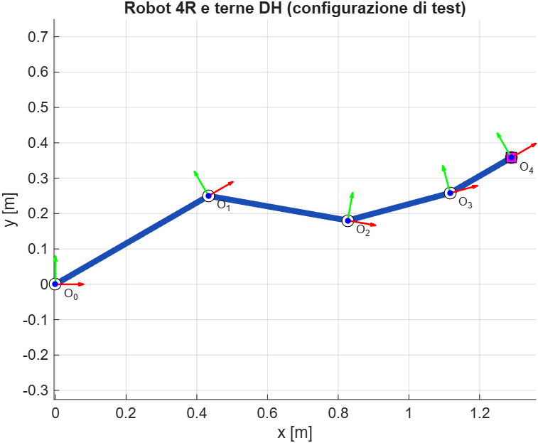
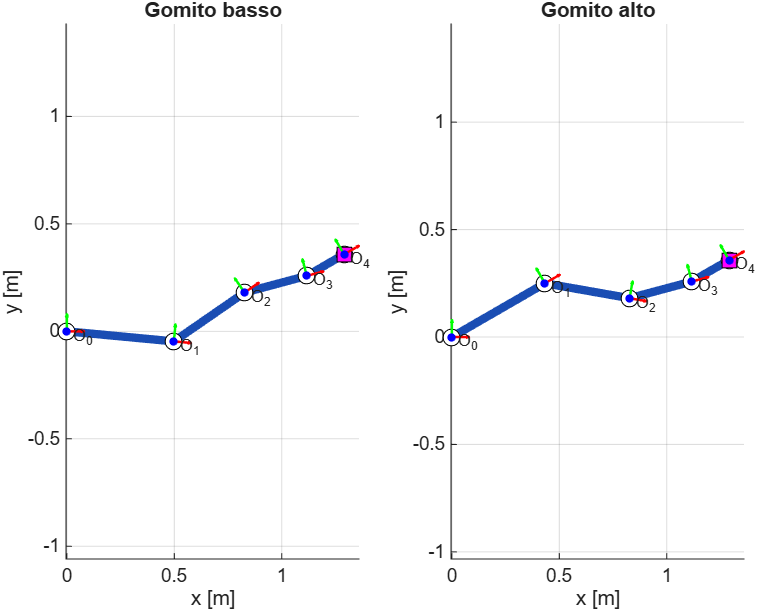
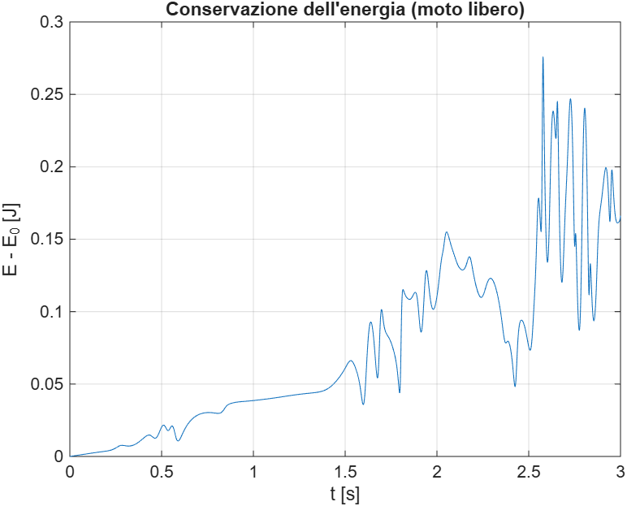
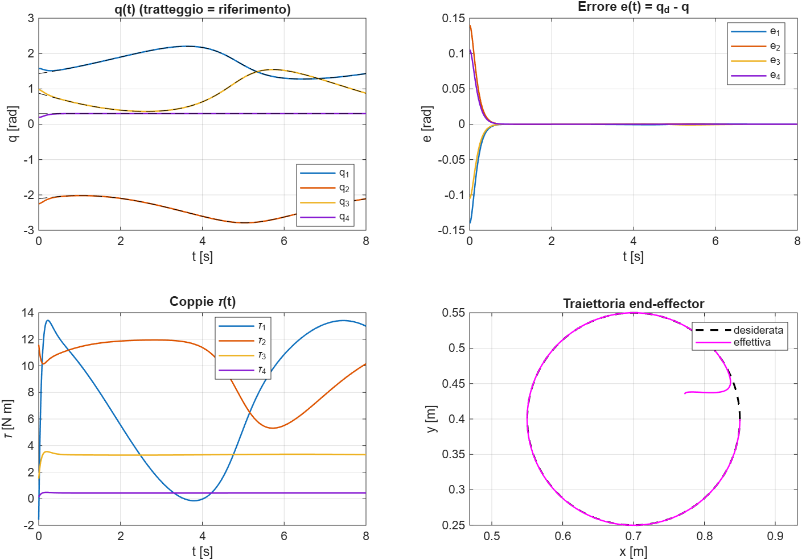
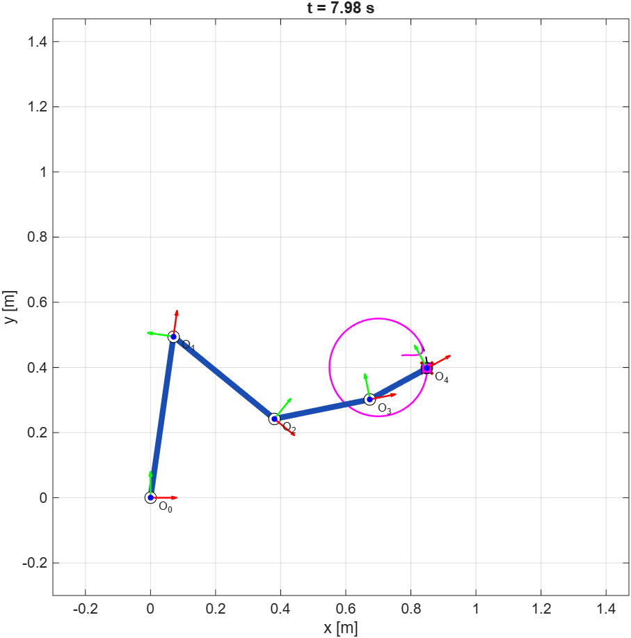

# Robot manipolatore planare 4R con gravità

Progetto MATLAB su un braccio planare a quattro giunti rotoidali che si muove nel piano XY, con la gravità lungo -y. Si parte dalla cinematica diretta e inversa, si ricava la dinamica con Eulero-Lagrange e si controlla il robot a coppia calcolata, facendogli seguire con l'end-effector una traiettoria circolare. Unità SI, angoli in radianti, rotazioni positive antiorarie.

## Come eseguirlo

Si mettono tutti i file `.m` nella stessa cartella, la si imposta come cartella corrente e si lancia `main_4R`. Lo script controlla cinematica e dinamica, simula con `ode45` e mostra grafici e animazione. `derive_dynamics_symbolic` ricava `M`, `C` e `G` in forma simbolica e li confronta con la versione numerica (serve il Symbolic Math Toolbox).

Con `matlab -batch "main_4R"` le figure si chiudono a fine esecuzione; per vederle usare l'interfaccia grafica o `matlab -r "main_4R"`.

## Il codice

`fk_4R` moltiplica le quattro matrici DH standard e restituisce posizione e orientamento dell'end-effector più le terne intermedie. I giunti sono quattro ma le terne cinque: la terna 0 è la base e la terna 4 coincide con l'end-effector.

`ik_4R` risolve la cinematica inversa. Con tre coordinate (x, y, phi) e quattro giunti il robot è ridondante di un grado, quindi si fissa `theta4`; poi si risale al polso, si risolve il problema 2R con la legge dei coseni e si ricavano gli altri giunti. Il gomito (alto o basso) si sceglie con un'opzione. Se il punto non è raggiungibile viene sollevato l'errore `ik_4R:Unreachable`.

`dynamics_4R` calcola `M` dai Jacobiani dei baricentri, `G` dal gradiente dell'energia potenziale e `C` con i simboli di Christoffel. `derive_dynamics_symbolic` fa lo stesso in modo simbolico e serve da controprova. `plot_robot_4R` disegna il robot con le terne DH, sia nelle figure statiche sia nell'animazione.

## Verifiche

Prima di simulare, `main_4R` controlla con `assert` che: `phi` sia la somma dei giunti, la parte rotazionale di `T` sia ortogonale, `FK(IK(p))` ridia il punto di partenza con entrambi i gomiti, un punto irraggiungibile dia l'errore previsto, `M` sia simmetrica definita positiva e l'energia si conservi nel moto libero. Alla fine controlla anche che l'errore di inseguimento dopo il transitorio resti sotto 0.01 rad. La derivazione simbolica verifica inoltre che `Mdot - 2C` sia antisimmetrica.

Le figure in `results/` sono state esportate con `exportgraphics` dalle finestre aperte da `main_4R`.

## Risultati

Il codice è stato eseguito su MATLAB Online (R2026b) e tutti i controlli preliminari sono stati superati. Per la configurazione di test, con giunti a 30, -40, 25 e 15 gradi, l'end-effector si trova in x = 1.2899 m e y = 0.3582 m con orientamento phi = 0.5236 rad. La cinematica inversa ritrova la stessa posa con entrambi i gomiti: il gomito alto restituisce esattamente la configurazione di partenza, mentre quello basso ne trova una diversa (-5.37, 40.00, -19.63 e 15.00 gradi) che raggiunge lo stesso punto. L'errore di ricostruzione FK(IK(p)) è dell'ordine di 1e-16, cioè al limite della precisione di macchina.

Nel moto libero l'energia parte da 6.82 J e varia al massimo di circa 1.2e-08 J, compatibile con la tolleranza di `ode45`.

Con il controllore, partendo da un errore di circa 0.25 rad, il robot converge sulla circonferenza in circa due secondi: dopo l'errore resta sotto 1.2e-08 rad e a fine simulazione è 1.6e-11 rad sui giunti e 5.5e-12 m sull'end-effector. Le coppie massime sono circa 13.4, 11.9, 3.5 e 0.5 N m, dalla base all'estremo.

### Figure

Robot nella configurazione di test, con le terne da `O_0` (base) a `O_4` (end-effector); asse x in rosso, asse y in verde.

Lo stesso punto raggiunto con le due soluzioni della cinematica inversa: gomito basso a sinistra, alto a destra.

Scarto di energia nel moto libero: resta intorno a 1e-8 J e cresce un po' verso la fine per l'errore di integrazione, ma è molto sotto la soglia del test.

Risultati del controllo: i giunti seguono il riferimento (tratteggiato) quasi subito e l'errore si azzera in meno di un secondo. Nel grafico in basso a destra si vede la breve rincorsa iniziale, dovuta all'errore di partenza imposto di proposito.

Ultimo fotogramma dell'animazione, con la scia dell'end-effector.

## Controllore e traiettoria

Il riferimento è una circonferenza nello spazio operativo, portata nello spazio dei giunti con la cinematica inversa e interpolata con una spline per avere velocità e accelerazioni. La legge di controllo è `tau = M(q)(ddq_d + Kd e' + Kp e) + C(q,dq) dq + G(q)`, che rende l'errore un sistema lineare asintoticamente stabile; i guadagni danno smorzamento critico. Il modello del controllore coincide con quello simulato, quindi non ci sono attriti, saturazioni delle coppie o errori di modello.
